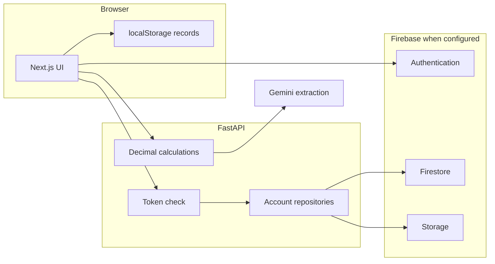

# Hackathon demo

BijliBachat AI 2.0 is a household electricity decision tool for Pakistan. The demo below uses the running app. It does not use invented users, savings, accuracy, or partnerships.

## A. Introduction

**Product.** BijliBachat AI 2.0.

**Tagline.** Don't wait for the bill. Predict it, prevent it, and reduce it.

**Problem.** A household often sees the cost of electricity only when the bill arrives. The bill mixes units, fixed charges, and taxes. A small change in units can move the household into a more expensive slab, and the slab rules differ by company and by date. People guess which appliance matters, and they cannot tell a calculated figure from a number read off a photo.

**Why it matters.** Electricity is a regular household expense. A late surprise is harder to act on than a number the household can see during the month. The useful action is specific: check the meter, see whether the month is running high, and change a schedule the household actually controls.

**Solution.** The app walks through one month in five steps. The household can understand the position, predict the cycle from confirmed meter checkpoints, see when a slab edge cannot yet be verified, try an appliance schedule, and compare a finished cycle with what was forecast. Python calculates the quantities. Gemini, when a server key is configured, only reads a bill or a meter photo into fields a person must confirm. Sample overview figures stay labeled **Demo data**.

## B. Walkthrough

Plan for about four minutes. Start with Firebase settings empty so the demo does not depend on a cloud account. The API can run locally. Reset this browser from Settings before you begin if a previous session left checkpoints behind. That reset does not delete an account and does not change the sample overview.

Say which screen is sample data as you open it.

1. **Understand.** Open Overview. The household card, the bill, the chart, and the saving are sample data. Point at the trust chips and the words Demo data. Open Settings and show that language can switch to Urdu, which turns the layout right to left, and that the theme can switch. With Firebase unset, Account and data says records stay in this browser and sign-in is not available.
2. **Predict.** Open Forecast. Enter or reuse confirmed checkpoints only if you want a live calculation. Otherwise explain that a cycle estimate appears after at least three checkpoints across seven complete days, and that a rupee forecast stays unavailable because GST, fuel price adjustment, electricity duty, and the TV fee are not in the loaded tariff. The budget typed here stays in this browser.
3. **Prevent.** Open Meter Readings. Type a register reading or, if Gemini is configured, review a photo. The photo draft stays unconfirmed until you accept it. Open Cliff Guard. The gauge stays hidden because no loaded tariff file contains a verified threshold. Say that plainly. Do not quote a 200-unit cutoff.
4. **Optimize.** Open Action Plan. Add an appliance with a wattage you type. Compare a shorter schedule. The difference is in kWh. PKR savings stay unavailable. The action list comes only from a change you entered.
5. **Measure.** Open Consumption History. Group two confirmed checkpoints into a cycle. If you saved a forecast while it was estimated, compare it with the measured cycle. The comparison is a difference, not an accuracy score and not a rupee saving.

If you turn Firebase on for a later pass, sign in and use Copy these records only after saying the list aloud. A failed copy leaves the browser records in place. Do not describe that copy as continuous sync. Leave “Keep this file in my account” unchecked unless you intend to store that file.

## C. Architecture

The browser renders trust labels and calls the API for calculations. Tariff maths, meter validation, Cliff Guard, the forecast, appliance use, and history comparisons stay in Python `Decimal` services. Gemini extracts bill fields or a meter reading and can explain a result the Python services already produced. It does not set a rupee total.

Firebase Authentication identifies a person. Firestore documents live at `users/{uid}/...` with `owner_uid` set by the server. Storage keeps a bill or meter file only after an explicit choice, under `users/{uid}/retained/{id}`, with no public URL. Security rules deny every other path. The Admin SDK bypasses those rules, so the API checks the token as well.

Local/demo mode is the default when the public Firebase settings or the Admin credentials are absent. The overview sample is compiled into the page. It is not written into a signed-in household. Settings can clear the browser’s own checkpoints, appliances, forecasts, and history without touching theme, language, or an account copy.

## D. Limitations to say out loud

- The loaded IESCO residential file has energy and fixed charges from the company’s February 2026 guide. GST, fuel price adjustment, electricity duty, and the TV fee are not in that guide, so there is no payable bill and no PKR saving.
- LESCO, K-Electric, and IESCO protected consumption are not calculated.
- Cliff Guard has no verified threshold. A slab edge is not used as one.
- The app does not read a live meter. A checkpoint is typed or confirmed from a photo.
- Browser records are not continuously synchronized. The first cloud copy of an id is kept.
- Sign-in and cloud copies need a Firebase project. File retention also needs a bucket. This repository’s deployment notes do not include a verified public URL.
- Health does not call Firebase or Gemini, so those checks stay unavailable.
- The file-check limit is inside one API process. It is not a network-wide quota.
- This is not a certified security audit.

## E. Questions a judge may ask

**What is technically different?** The product separates a labeled sample, an unconfirmed extraction, and a calculated result. Python owns every quantity. A photo or a model response cannot confirm itself, and a partial tariff cannot become a payable total.

**Why is this useful?** A household can see the month before the bill arrives, check a meter reading, and try a schedule in kilowatt-hours without pretending the rupee impact is known.

**How does it avoid a hallucinated bill?** Gemini returns fields with a confidence. The audit form starts unconfirmed. The person submits the values. The tariff engine prices only components present in a dated file. Missing taxes stay missing. They are not treated as zero.

**How does it handle an uncertain meter reading?** An unreadable digit stays blank. The draft stays pending until the person confirms or corrects it. A confirmed checkpoint records whether it was calculated, extracted, or estimated. It is not marked verified just because someone typed it.

**What happens without internet or Firebase?** The sample overview still opens. Records already in this browser stay there. Account actions say they are not configured, or they fail without clearing local data. Calculations need the API. They do not run inside the page.

**How is user data protected?** The UID comes from a verified token. One user cannot read another user’s documents or files through the API or through the security rules. Files are stored only after a checkbox. Tokens and private keys are not written into household records. Production CORS is an explicit HTTPS origin.

**What is the current limitation?** A complete payable tariff and a verified Cliff Guard threshold are still missing, and no production host has been verified from this repository.

**What would be added next?** A dated source for the missing tariff components, a verified slab threshold if a regulator publishes one, and then the hosting steps in [DEPLOYMENT.md](DEPLOYMENT.md). Notification delivery stays out until that exists. The bell in the header is an empty state on purpose.
